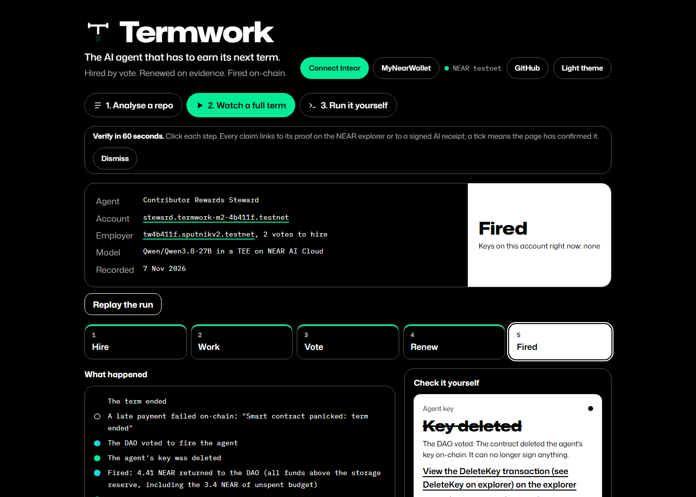
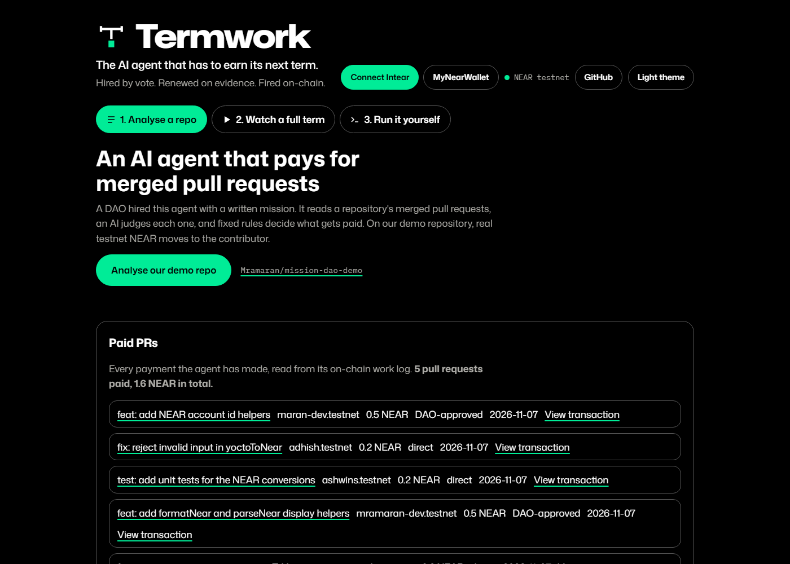
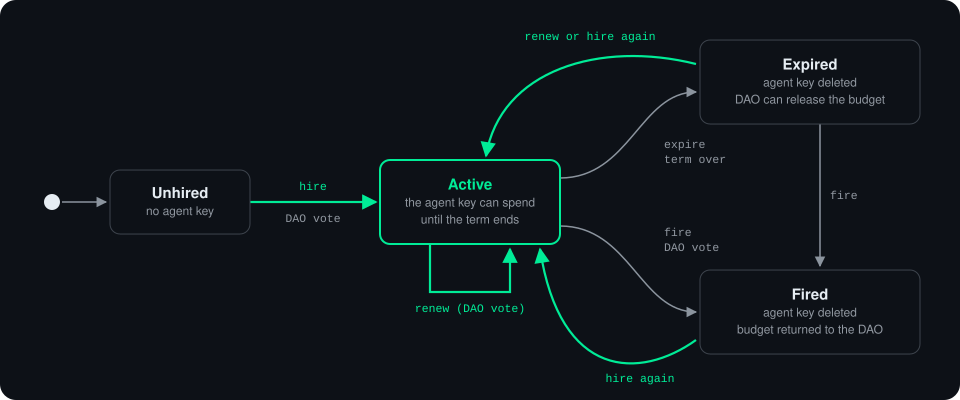

<p align="center">
  <picture>
    <source media="(prefers-color-scheme: dark)" srcset="brand/termwork-c-span-lockup-dark.svg">
    
  </picture>
</p>

<h3 align="center">The AI agent that has to earn its next term.</h3>
<p align="center"><i>Hired by vote. Renewed on evidence. Fired on-chain.</i></p>

<p align="center">
  <a href="https://termwork-nu.vercel.app"></a>
  
  
  
  <a href="LICENSE"></a>
</p>

<p align="center">
  <a href="https://termwork-nu.vercel.app/#repo"><b>Analyse a repo</b></a> ·
  <a href="https://termwork-nu.vercel.app/#watch"><b>Watch a full term</b></a> ·
  <a href="https://termwork-nu.vercel.app/#yourself"><b>Run it yourself</b></a> ·
  <a href="#try-it"><b>Quick start</b></a>
</p>

https://github.com/user-attachments/assets/1e7a2f23-7f21-4bc1-87db-1c191ec920ed

<p align="center"><i>The pitch, 2:41: why agents need a term, then a full run on real pull requests.</i></p>

Termwork lets a [Sputnik DAO](https://github.com/near-daos/sputnik-dao-contract) on NEAR testnet hire an AI agent, the Contributor Rewards Steward, for a fixed term. The agent pays merged pull requests from a budget, sends anything large to a DAO vote, and files a renewal case when the term nears its end. The DAO can fire it at any time, and the contract then deletes the agent's key itself.

## At a glance

| | |
|---|---|
| **Problem** | Communities hand money to AI agents with only an on/off switch: a key nobody can take back, or a permanent allowance. |
| **Termwork** | The agent gets a term, a budget and a written mission from a DAO vote. It must file a renewal case to keep the job, and the DAO can fire it. |
| **Safety** | The model never sees a key. A fixed-rule validator, a local signer with five operations, and the contract's own limits stand between the model and the money. |
| **Proof** | 5 real pull requests paid 1.6 NEAR on testnet, a recorded term from hire to fire, and every AI decision signed inside a TEE. |
| **Stack** | Rust contract (near-sdk 5), TypeScript agent and signer, NEAR AI Cloud, React on Vercel. |

## Contents

- [The problem](#the-problem)
- [Proof it works](#proof-it-works)
- [Try it](#try-it)
- [The end-to-end demo](#the-end-to-end-demo)
- [The web page](#the-web-page)
- [Real pull requests](#real-pull-requests)
- [How it works](#how-it-works)
- [Where the key lives and why the model never sees it](#where-the-key-lives-and-why-the-model-never-sees-it)
- [Local development and deploying](#local-development-and-deploying)
- [Tests](#tests)
- [Built during NEAR HACKATHON](#built-during-near-hackathon)

## The problem

Communities are starting to hand real money to AI agents, but all they can do is switch them on or off. Either one member runs the agent with a key the community cannot take back, or a wallet gets a permanent allowance and the agent runs until someone notices a problem. Nobody checks whether the agent is still worth paying, nothing ends it by default, and a prompt-injected agent holding a raw key can reach whatever that key reaches.

## Proof it works

Every claim below can be checked on the NEAR explorer.

**A full term, recorded on 2026-11-07.** The agent `steward.termwork-m2-4b411f.testnet`, hired by the DAO `tw4b411f.sputnikv2.testnet` (`AGENT_MODE=live`, `DEMO_SOURCE=github`), worked the 7 real merged pull requests of [`Mramaran/mission-dao-demo`](https://github.com/Mramaran/mission-dao-demo). The model (`Qwen/Qwen3.8-27B`) paid #1, #4 and #7 (0.2 NEAR each), sent #2 and #5 to DAO votes that approved and paid them (0.5 NEAR each), and skipped #3 and #6 as formatting-only changes. All 7 decision receipts are `verified: true`. The **Watch a full term** tab replays this run.

| Step | Transaction |
|---|---|
| The DAO hires the agent | [`12THF4Mc…`](https://testnet.nearblocks.io/txns/12THF4McgH6so9Vo7pkszK1nt64hMHYof6aARytgandq) |
| The agent pays PR #4 (0.2 NEAR) directly | [`3H6Rpxo…`](https://testnet.nearblocks.io/txns/3H6RpxoZPNgdKTvacm6tSrEhbyjfpgYCS6uYcKmZZU8i) |
| The council's vote approves and pays PR #5 (0.5 NEAR) | [`9HPRJY8…`](https://testnet.nearblocks.io/txns/9HPRJY8FMexFrGJJA6W2UNqfdAD5PMvZZen3vhgrupPU) |
| A payment after the term ended fails on-chain | [`48H3tuR…`](https://testnet.nearblocks.io/txns/48H3tuRiXxuyA4dfNTQzJZgFLsVckbQkTZ9BdDzxbNHv) |
| The DAO fires the agent | [`CSkLbhD…`](https://testnet.nearblocks.io/txns/CSkLbhDioLaXRigYeAm8q4vZdQwAPiou48DuJtBkqKEU) |

**The live agent.** The site's **Paid PRs** panel reads a second, still-running agent, `steward.termwork-m2-7d326c.testnet` (DAO `tw7d326c.sputnikv2.testnet`), which has paid 5 pull requests of the same demo repository, 1.6 NEAR in total. Because it is a separate deployment, the same pull requests were paid once by each agent. Each paid pull request on GitHub carries a `💰 paid` label and a comment with its transaction link.

<p align="center">
  
</p>

## Try it

Everything runs on NEAR **testnet**; the code refuses any other network. You need Node 22 or newer. A prebuilt mandate wasm is committed at `contracts/mandate/res/termwork_mandate.wasm`, so Rust is optional.

**Quick start: the whole term in one command (about 12 minutes).**

```bash
git clone https://github.com/Mramaran/termwork.git
cd termwork
npm ci
npm test
cp .env.example .env
npm run -w scripts demo
```

This runs in fixture mode, with no keys. To use the real model, set `AGENT_MODE=live`, `NEARAI_API_KEY` and `NEARAI_MODEL` in `.env` first. [The end-to-end demo](#the-end-to-end-demo) explains what it checks.

### Step by step

Step 3 builds from source and needs Rust with the `wasm32-unknown-unknown` target and `cargo-near`; step 4 deploys that build if it exists, and the committed wasm otherwise.

| # | Step | Command | What you should see |
|---|---|---|---|
| 1 | Install | `npm ci`, then `npm test` | Both finish without errors. |
| 2 | Create a DAO | `npm run -w scripts setup-dao` | `setup-dao done: <name>.sputnikv2.testnet` |
| 3 | Build the contract (optional) | `cd contracts/mandate && cargo near build non-reproducible-wasm && cd ../..` | `contracts/mandate/target/near/termwork_mandate.wasm` |
| 4 | Deploy it | `npm run -w scripts deploy` | `mandate: steward.…, access keys: []` |
| 5 | Hire the agent | `npm run -w scripts hire -- --term 3600` | `hired: proposal N approved, term 3600s` |
| 6 | Configure the processes | Add `SIGNER_TOKEN` to `.env` | |
| 7 | Start the signer (terminal 1) | `npm run -w signer start` | `[signer] listening on http://127.0.0.1:8787 for steward.…` |
| 8 | Start the agent (terminal 2) | `npm run -w agent start` | `agent started (mode=…, source=fixtures, interval=30000ms)` |
| 9 | Vote | `npm run -w scripts vote <proposalId> approve` | `proposal <id>: <status>` |
| 10 | Fire the agent | `npm run -w scripts fire` | `returned to DAO: <amount> NEAR` |
| 11 | Run the whole story at once | `npm run -w scripts demo` | A `PASS` line per check |

<details>
<summary><b>Details for each step</b></summary>

1. **Install.** `npm ci` should finish without errors. `npm test` then runs the TypeScript tests, which should pass.
2. **Create a DAO.** `setup-dao` takes 3 faucet accounts (`termwork-m1-<id>.testnet` to `m3`) from `https://helper.nearprotocol.com` and creates a 2-of-3 Sputnik DAO. It writes `DAO_ID` to `.env` and the account names to `.termwork-state.json`.
3. **Build the contract (optional).** Skip this step to deploy the committed wasm; its sha256 is in [`contracts/mandate/res/README.md`](contracts/mandate/res/README.md).
4. **Deploy it.** `deploy` logs which wasm it uses (the `target/near` build if present, else `res/`), creates `steward.<member 2>`, deploys the contract, calls `new` and deletes the account's only key. It writes `MANDATE_ID` to `.env`.
5. **Hire the agent.** `--term` is in seconds (default 2592000, which is 30 days) and `--budget` in NEAR (default 5). `hire` generates the agent keypair, writes `AGENT_PRIVATE_KEY` to `.env` without printing it, files the `hire` proposal and casts two council votes. The mandate's only access key is now the agent's function-call key.
6. **Configure the processes.** You can generate a `SIGNER_TOKEN` with `node -e "console.log(require('crypto').randomBytes(24).toString('hex'))"`. Every variable is listed in [`.env.example`](.env.example).
7. **Start the signer** in one terminal.
8. **Start the agent** in a second terminal. It prints a log line for each pull request it handles. The mode comes from `AGENT_MODE` in `.env`:
   - `AGENT_MODE=fixture`: no model and no key; deterministic rules decide. Receipts are labelled model `fixture-rules`, `verified: false`.
   - `AGENT_MODE=replay`: no model call and no NEAR AI key; the agent reuses the receipts in `receipts/`, matched by pull request URL. The committed receipts come from live runs (see [Receipts](#receipts)), so replay shows the real model's decisions. A pull request with no stored receipt is logged as `no stored receipt for <url>`.
   - `AGENT_MODE=live`: NEAR AI Cloud decides. This needs `NEARAI_API_KEY` and `NEARAI_MODEL`.

   With `SOURCE=fixtures`, the contributor accounts in `fixtures/prs.json` are placeholders (`*.invalid`) that cannot exist on testnet, so outside the demo the agent logs `recipient account does not exist` and pays no one. Only `npm run -w scripts demo` creates real recipient accounts (sub-accounts of a council member) and maps the fixture names onto them.

   The agent process exits with `mandate is no longer active, agent stopped` when the mandate's status is not Active, so restart it after a DAO renewal.
9. **Vote.** When the agent asks for a payment above the spend threshold, or files a renewal case, it creates a DAO proposal. `vote` (with `approve` or `reject`) casts council votes until the proposal passes or fails. A renewal proposal is not tied to a term. One left open from an earlier term, or from before a fire and re-hire, still renews the current agent if the council approves it, so reject stale renewal proposals rather than voting them through.
10. **Fire the agent.** `fire` passes a `fire` vote, waits until the mandate has no access keys and sweeps the leftover funds to the DAO.
11. **Run the whole story at once** with `npm run -w scripts demo`, described below.

</details>

### The end-to-end demo

`npm run -w scripts demo` does steps 2 to 10 in one process, with its own signer and agent loop. It takes about 12 minutes and about 30 NEAR of testnet faucet funds, from up to 3 faucet accounts via `https://helper.nearprotocol.com`. The faucet rate-limits, and the script says so if it refuses. The demo deploys the committed wasm unless you built your own in step 3. The demo term is 5 minutes (`DEMO_TERM_SECS`).

The agent mode is `AGENT_MODE` from `.env`, else `live` when `NEARAI_API_KEY` is set, else `fixture`. A `.env` copied from `.env.example` sets `AGENT_MODE=fixture`, so change it to `live` to use the real model.

By default the agent works the made-up PRs in `fixtures/prs.json`. With `DEMO_SOURCE=github` it works the real merged PRs of `DEMO_REPO` (default `Mramaran/mission-dao-demo`) from the last `DEMO_DAYS` days (default 30), and pays the accounts in their `near:` lines; set `GITHUB_TOKEN` to stay within GitHub's search limit. The demo makes its own DAO, mandate and agent key, and puts `.termwork-state.json` and `.env` back when it ends, so a live deployment keeps its own agent. Afterwards, `npm run -w scripts export-run` turns the run into `web/public/run.json` for the replay.

The script prints a `PASS` line for each check, in this order:

| # | Check |
|---|---|
| 1 | The mandate has no access keys after setup. |
| 2 | After `hire`, the agent's function-call key is the only key. |
| 3 | The agent pays merged pull requests, sends the big ones to a DAO vote and skips the rest. In fixture mode the counts are exact (3 paid, 1 request, 1 skip); with a live model they depend on the model. |
| 4 | The DAO approves each big spend and the money moves. With `DEMO_BIG_SPEND=reject` it votes them down instead, and no money moves. |
| 5 | The agent files its renewal case, and every `[#n]` citation in the report points at a real work-log entry. |
| 6 | The term ends. A late `spend` is sent anyway and fails on-chain with `term ended`. |
| 7 | The DAO votes `fire` and the key list becomes empty. `fire` returns the budget to the DAO, and `sweep` forwards the proposal bonds that Sputnik returns after the fire. |
| 8 | The agent retries with its old key, and the chain rejects it as a deleted access key. |

The run writes `demo-output.json` (git-ignored) with every transaction hash and account. The transactions in [Proof it works](#proof-it-works) come from such a run.

## The web page

The site is live at <https://termwork-nu.vercel.app>, with a **Connect Intear** (or MyNearWallet) button in the header. It has three tabs, meant to be visited in order:

<p align="center">
  
</p>

| Tab | What it does |
|---|---|
| **1. Analyse a repo** | Runs the agent on real GitHub pull requests (see [Real pull requests](#real-pull-requests)). Its **Paid PRs** panel lists every payment the agent has made, read from its on-chain work log. |
| **2. Watch a full term** | Replays the recorded run in five steps: Hire, Work, Vote, Renew and Fired. Each step has a feed of what happened and a "Check it yourself" list of links to the NEAR explorer and to the signed AI receipts. |
| **3. Run it yourself** | The commands to reproduce the run on testnet, from a fresh clone to firing the agent. |

In **Watch a full term**, a link gets a tick only after the page has confirmed it: the transaction hash is present, the receipt loads with `verified: true`, the report hash matches the one on-chain, or the agent account has no keys left. Where the AI's renewal report disagrees with the contract's figures, the page points this out and goes by the contract.

The footer links to the **Terms and conditions** (`#terms`) and **Privacy policy** (`#privacy`). Both say that Termwork is a hackathon demonstration on testnet, and list what data the site handles and where it goes.

### Real pull requests

**Any repository: analysis only.** Type `owner/name` (or a GitHub link) or click one of the example repositories, pick the merge window (last week, last month or custom dates) and click **Analyse**. The page reads up to 30 pull requests merged in that window, asks the model about each one, and passes each answer through the same fixed-rule validator the agent uses. Each row says what the agent would do: pay directly, send the payment to a DAO vote, skip it with a reason, or show what it would earn as **unclaimed** when the pull request has no `near:` line. For an unclaimed pull request the model is given a placeholder account, so it judges the change itself rather than refusing for the missing account.

> [!NOTE]
> The server reads GitHub with its own token (`GITHUB_TOKEN`). Any public repository works. A private repository works only if that token can read it; the token is never sent to the browser and is scrubbed from every response. Outside the demo repository, nothing is written to GitHub: no payment, no `💰 paid` label and no comment, and the **Paid PRs** panel never lists it, because only the demo repository gets real payments.

**The demo repository: real payments.** [`Mramaran/mission-dao-demo`](https://github.com/Mramaran/mission-dao-demo) is on the server's allowlist (`PAYABLE_REPOS`). Click **Analyse our demo repo**, and each pull request that can be paid shows **Ready to pay** with the AI's estimated amount. Paying works like this:

1. A council member connects their wallet in the header and clicks **Run payments**. The wallet signs a short-lived message (NEP-413), which the server checks against the account's on-chain keys and the DAO's council list. Other visitors can watch, but cannot trigger a payment.
2. For each pull request that is ready, the server reads it again from GitHub, asks the model again and runs the validator. It also checks that the recipient account exists on testnet and that the pull request has not already been paid or sent to a vote. Only then does the agent key sign. The amount and recipient always come from the server's own checks, never from the browser.
3. The agent pays up to 0.2 NEAR at once (`spend`). A larger reward (0.5 NEAR, for a pull request with a `feature` label or more than 200 changed lines) becomes a DAO proposal (`request_spend`), and the row shows **Approve & pay**. One council vote from the wallet passes it, and the DAO pays the contributor.
4. When a payment lands, the pull request on GitHub gets a `💰 paid X NEAR` label and a comment with the transaction link. For a direct payment, the comment also carries the agent's decision receipt. For a DAO-approved payment, the server first checks the vote transaction on chain.

**What gets paid.** The mission rewards every valid merged pull request. A trivial change (a typo fix, a whitespace or formatting-only change, or an automated bot update) earns nothing; a code change that fixes a bug or adds behaviour always counts, however small. Each pull request is paid at most once, because the contract records its URL. The contributor's account has to be on its own line at the end of the pull request description:

```
near: yourname.testnet
```

**Limits.** Analysing a repository other than the demo repo makes one model call per pull request, so each visitor can run it twice a minute. The demo repo's analysis, payments and labels have separate limits. The agent can never spend more than the budget the DAO voted, and the agent key's gas allowance is 0.25 NEAR.

## How it works

### Architecture

The model can only advise. Fixed rules, a local signer and the contract decide what happens to the money, and the DAO decides who holds the job.

<p align="center">
  
</p>

The green boxes are the contract that holds the budget and the signer that holds the agent's only key. On the website, the hosted `/api/pay` function holds the same key as a Vercel secret. When the agent asks for a larger payment or files its renewal case, the contract opens a proposal on the DAO, and the council votes on it.

### Paying one pull request

<p align="center">
  
</p>

### The agent's term

<p align="center">
  
</p>

Who can call each method:

| Caller | Methods |
|---|---|
| The DAO only | `hire`, `renew`, `fire`, `release` (after expiry, budget back to the DAO), `execute_approved_spend` |
| The agent's function-call key | `spend`, `request_spend`, `log_work`, `propose_renewal`, `expire` |
| Anyone | `expire` (after the term ends), `sweep` (after a fire, funds to the DAO) |

| Part | Folder | What it does |
|---|---|---|
| **Mandate contract** | `contracts/mandate` (Rust, near-sdk 5) | The DAO calls `hire`, `renew` and `fire` through Sputnik proposals, and the contract adds or deletes its own function-call key in response. `spend` pays directly, only once per evidence URL, and only within the clause maximum, the spend threshold and the remaining budget. That budget is the DAO-voted total (the hire deposit plus renewal top-ups), never the account balance. A larger payment goes through `request_spend`, which opens a DAO proposal. `propose_renewal` stores the agent's report on-chain and opens a renewal proposal; only one can be open per term. After the term, `expire` (called by the agent key or anyone) ends the mandate and deletes the key, and the DAO calls `release` to take the remaining budget back. After a `fire`, anyone can call `sweep` to forward leftover funds to the DAO. |
| **Signer** | `signer` | A local HTTP server on `127.0.0.1` that requires a bearer token and exposes exactly five operations: `spend`, `request_spend`, `log_work`, `propose_renewal` and `expire`. It uses a fresh nonce for every transaction and runs them one at a time. If the RPC times out, it answers `504` with "outcome unknown", since it cannot tell whether the transaction landed. It talks only to the testnet RPC hosts on an allowlist. |
| **Agent** | `agent` | Reads merged pull requests from `fixtures/prs.json` (`SOURCE=fixtures`) or the GitHub API (`SOURCE=github`, with `GITHUB_REPO`). For each one it builds a prompt from the mandate, gets a decision from the model, and passes it through a fixed-rule validator (`agent/src/validate.ts`) that turns it into exactly one action: pay, request a vote, or log a skip. The validator skips, for example, a pull request that was already paid or has no NEAR account. The agent never signs anything itself. |
| **Receipts** | `receipts` | Each model answer is stored as a JSON file named by its SHA-256, and the work-log entry carries that hash. |
| **Web** | `web` | Vite and React, reading testnet JSON-RPC directly. The `web/api` functions analyse repositories and pay the demo repository. |

### What "verified" means

A receipt is `verified: true` only if all of these hold:

1. The response signature was made by a signing address listed in the model's attestation report.
2. `signature_kind` is `provider_tee`.
3. The signed text names the requested model and carries the SHA-256 of the request and of the response.
4. The attestation report echoes the fresh nonce sent with that request.

> [!IMPORTANT]
> Termwork does **not** verify the Intel TDX quote or the NVIDIA NRAS GPU evidence, so it does not prove that the signing address belongs to genuine TEE hardware. The `verifiedScope` field of each receipt says what was checked: `response-signature+model+nonce` or `none`.

### Model, speed and cost

The agent uses `Qwen/Qwen3.8-27B` on NEAR AI Cloud, a model NEAR AI runs inside a TEE (`owned_by: nearai`). Set it with `NEARAI_MODEL`. NEAR AI prices it at **$0.04 per million input tokens** and **$1.35 per million output tokens**.

These figures come from the recorded run of 2026-11-07 on the 7 real merged pull requests of [`Mramaran/mission-dao-demo`](https://github.com/Mramaran/mission-dao-demo). Every number is read from the 8 signed receipts in `receipts/`, so anyone can check it.

| PR | Title | Model's decision | Outcome |
|---|---|---|---|
| #1 | fix: reject negative amounts in nearToYocto | clause 2, 0.2 NEAR: a bug fix | Paid directly |
| #2 | feat: add formatNear and parseNear display helpers | clause 3, 0.5 NEAR: `feature` label | Paid after a DAO vote |
| #3 | docs: fix README heading formatting | clause 1, nothing: formatting only | Skipped |
| #4 | fix: reject invalid input in yoctoToNear | clause 2, 0.2 NEAR: a bug fix | Paid directly |
| #5 | feat: add NEAR account id helpers | clause 3, 0.5 NEAR: `feature` label | Paid after a DAO vote |
| #6 | docs: wrap a long line in the README | clause 1, nothing: formatting only | Skipped |
| #7 | test: add unit tests for the NEAR conversions | clause 2, 0.2 NEAR: new tests | Paid directly |

| | Per pull request | Whole run (7 decisions and the renewal report) |
|---|---|---|
| Tokens | 556 to 572 input, 66 to 98 output | 5,082 input, 1,083 output |
| Cost | about $0.00013 | about $0.0017 |
| Time | one decision about every 6 seconds | 7 decisions in 40 seconds, from the first model response to the last verified receipt |
| Receipts | `verified: true` | 8 of 8 `verified: true` |

At that rate, the $10 of NEAR AI credit that NEAR Builders offers covers thousands of runs.

Every chat request sends `reasoning_effort: "none"` and `temperature: 0` (`agent/src/nearai.ts`), and the receipts show 0 reasoning tokens in all 8 answers. The model is a reasoning model. In an earlier test with reasoning on, it spent about 1,750 thinking tokens and 45 seconds on one decision, and slower decisions ran past the demo's 5-minute term. Turning reasoning off does not weaken the receipts, because the answer is still signed by the model's TEE key (`signature_kind: provider_tee`). Temperature 0 makes the same pull request get the same decision on the analysis page and when it is paid. The decision is only advice: the fixed rules in `agent/src/validate.ts` and the contract's own checks decide what is paid.

### Receipts

The `receipts/` folder holds the live receipts from the recorded runs (model `Qwen/Qwen3.8-27B`, all `verified: true`), including the 8 from the run above: one per pull request decision, plus the renewal report. `index.json` maps each pull request URL, and `renewal:1`, to its receipt. Each receipt keeps the full request, response, signature and attestation report, so the checks above can be repeated offline. To record your own, set `AGENT_MODE=live`, `NEARAI_API_KEY` and `NEARAI_MODEL` in `.env` and run the agent or the demo. `NEARAI_ALLOW_UNVERIFIED=1` allows a model that NEAR AI does not own; its receipts are marked unverified.

## Where the key lives and why the model never sees it

- `hire` writes the agent's function-call private key to `.env` as `AGENT_PRIVATE_KEY`, and `.env` is git-ignored.
- The standalone signer (`npm run -w signer start`) is the only process that loads `AGENT_PRIVATE_KEY`. The standalone agent (`npm run -w agent start`) reads the same `.env` but drops that variable (`agent/src/env.ts`). Do not `export AGENT_PRIVATE_KEY` in the shell you start the agent from, or the agent process will inherit it.
- For convenience, `npm run -w scripts demo` runs the signer and the agent loop in one process, so in the demo the key is in that process's environment. It is still never sent to the model.
- The hosted `/api/pay` function holds the same kind of key as a Vercel secret. It signs only after its own checks, and only for allowlisted repositories.
- The model receives only prompt text built from the mandate and one pull request. It has no tools and no key; its answer is parsed as data and checked by the validator.
- The agent reaches the chain only through the signer's five operations. The signer is bound to `127.0.0.1`, needs the bearer token, and scrubs the key and the token from error text before it leaves the process.
- The key can only call the mandate's agent methods. The mandate account has no full-access key after deploy, and `fire` deletes the agent key. The demo's last step shows the old key being rejected.

## Local development and deploying

**Run the page locally.**

1. Put `VITE_MANDATE_ID`, `VITE_DAO_ID` and `VITE_NETWORK=testnet` in the repo-root `.env` (`web/vite.config.ts` sets `envDir` to the repo root).
2. Run `npm run -w web dev` and open the local URL Vite prints. The `/api/*` functions only run on Vercel. To use them from the dev server, set `API_PROXY=https://termwork-nu.vercel.app` (for example in a git-ignored `.env.development.local`), and Vite forwards `/api` there.
3. Voting from the page goes through a NEAR wallet (Intear or MyNearWallet). The CLI vote in step 9 always works.

<details>
<summary><b>Deploy to Vercel</b> (the static page plus the functions <code>decide</code>, <code>analyse</code>, <code>pay</code>, <code>label</code> and <code>paid</code>)</summary>

1. Once, run `npx vercel link --project termwork` at the repo root, and set these environment variables in the Vercel project (`.env.example` describes each one):
   - `NEARAI_API_KEY` and `NEARAI_MODEL`;
   - `MANDATE_ID`, `DAO_ID`, and `AGENT_PRIVATE_KEY` (the agent's function-call key, written to `.env` by `hire`);
   - `PAYABLE_REPOS`;
   - `GITHUB_TOKEN` (read access) and `GITHUB_LABEL_TOKEN` (labels and comments, demo repo only).

   The functions read them at request time and answer 503 if one they need is missing.
2. `npm run -w scripts deploy-vercel` makes a preview deployment, and `npm run -w scripts deploy-vercel -- --prod` updates <https://termwork-nu.vercel.app>. Pass `VITE_MANDATE_ID` and `VITE_DAO_ID` in the environment so the page reads the same mandate. The script first runs `npm test` and the web typecheck. It then builds `web`, bundles each function with esbuild, checks that every bundle loads and exports a handler, and runs a pinned Vercel CLI with `deploy --prebuilt`.

GitHub Pages is not used. Leave `.github/workflows/pages.yml` disabled in the repository settings: a Pages build has no `/api` functions, so analysis and payments would not work there.

</details>

## Tests

| Command | Runs | Needs |
|---|---|---|
| `npm test` (repo root) | The vitest suites of every workspace: signer, agent, web (the page and the `/api` functions), scripts and shared. | No network and no key. |
| `cargo test` (in `contracts/mandate`) | The unit tests and the sandbox lifecycle tests, which run the mandate next to the real Sputnik DAO wasm. | Linux, macOS or WSL (the near-sandbox binary is not available for native Windows), `cargo-near` and the `wasm32-unknown-unknown` target. |
| `cargo test --test lifecycle` | Only the lifecycle tests. They build the wasm themselves with `cargo near build non-reproducible-wasm`, so they always test the current source. | As above. See [`contracts/mandate/README.md`](contracts/mandate/README.md) for WSL tips. |

## Built during NEAR HACKATHON

Written from scratch during the hackathon; the first commit is dated 2026-11-05. These repositories were **read for patterns only, and no code was copied** from them:

- [near-daos/sputnik-dao-contract](https://github.com/near-daos/sputnik-dao-contract)
- [mikedotexe/near-payment-agent](https://github.com/mikedotexe/near-payment-agent)
- [near-examples/near-api-examples](https://github.com/near-examples/near-api-examples)
- [near-examples/nearai-cloud-verification-example](https://github.com/near-examples/nearai-cloud-verification-example)
- [NEAR-DevHub/trezu](https://github.com/NEAR-DevHub/trezu)

`contracts/mandate/tests/res/sputnikdao2.wasm` is the unmodified Sputnik DAO v2 binary from near-daos/sputnik-dao-contract (MIT licence), fetched from the `sputnikv2.testnet` factory. Only the contract's tests use it; `contracts/mandate/tests/res/README.md` records its source and hash.

## License

[MIT](LICENSE), copyright Termwork contributors.
